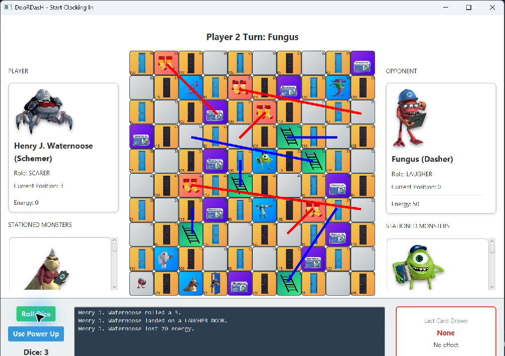

# DooRDasH

**Scare vs Laugh Touchdown** — a turn-based JavaFX board game inspired by *Monsters, Inc.*, developed for CSEN 401 at the German University in Cairo.

Choose a **Scarer** or **Laugher** and race across a 100-cell board. Collect energy, use your monster’s abilities, and draw action cards to reach **Boo’s Door with at least 1,000 energy**.

**Java · JavaFX · Object-oriented programming · JUnit 4**



## Gameplay

- Eight characters across four monster types, each with different abilities.
- Doors that reward or penalize your team, conveyor belts, and contamination hazards.
- Cards for swapping positions, stealing energy, shields, and confusion.
- Local play for two players, with animated movement and an action log.

[Read the full gameplay guide →](docs/GAMEPLAY.md)

## How to run

Install [JDK 21](https://adoptium.net/temurin/releases/?version=21), then download and extract this repository using **Code → Download ZIP**. Open a terminal in the extracted folder containing `pom.xml`.

**Windows**

```powershell
.\mvnw.cmd javafx:run
```

**macOS / Linux**

```sh
sh ./mvnw javafx:run
```

The included Maven Wrapper downloads Maven and JavaFX automatically on the first run. If Java is not detected, set `JAVA_HOME` to your JDK installation folder. Keep the three CSV files in the project root; they contain the game data.

## Code overview

- `src/game/engine` — board, turns, monsters, cards, and game rules.
- `src/game/controller` — connects player actions to the game engine.
- `src/game/view` — JavaFX interface and animations.
- `src/game/tests` — 165 JUnit tests.
- `src/resources` — images, icons, and music.

<details>
<summary>Running the tests</summary>

Use `.\mvnw.cmd clean verify` on Windows or `sh ./mvnw clean verify` on macOS/Linux. The existing automated checks run the build and tests on all three platforms.

</details>

## Credits

An educational project inspired by *Monsters, Inc.* Characters, imagery, and music belong to their respective owners.
